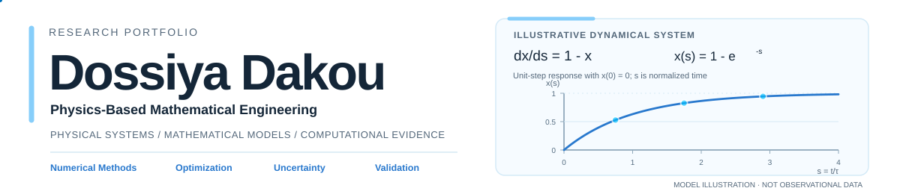
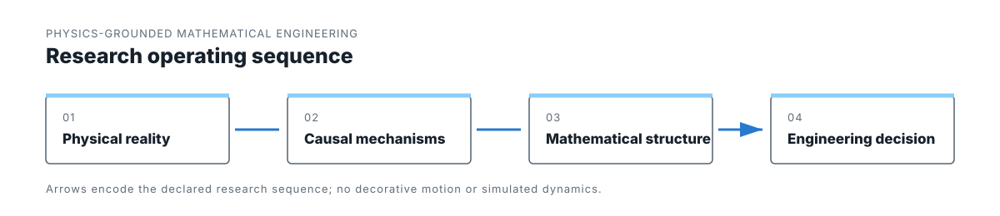

  

**Research:** Differential Geometry · Dynamical Systems · Graph-Based Modeling · Viability Theory · Power–Transportation Systems

## About Me

My academic journey began in **Electrical Engineering**, where I learned to connect mathematical principles with physical systems. I continued into **Physics**, specializing in Renewable Energy and Energy Systems, where I developed my interests in mathematical modeling and scientific computation.

Today, I pursue an **MSE in Sustainable Engineering at Arizona State University** and, in parallel, an **MSc in Financial Engineering at WorldQuant University**.

My work connects **physics, applied mathematics, and computational methods** to investigate complex engineering problems. I am particularly interested in understanding not only what models predict, but also the mathematical principles, physical assumptions, and evidence that justify their predictions.

**Scientific problem.** I study how **electrified-transportation demand, transformer thermal inertia, and uncertain operating limits** affect the operation and resilience of interconnected power–transportation infrastructure. This is the focus of my ongoing ASU MSE thesis.

**Mathematical and computational methods.** I work with **dynamical systems, differential equations, numerical methods, parameter estimation, uncertainty quantification, stochastic models, and constrained optimization**, using **Python, Julia/JuMP/HiGHS, and MATLAB**.

**Evidence of application.** In ongoing thesis work, I evaluated a first-order thermal model using **8,592 observations** (top-oil RMSE **0.2517°C → 0.2165°C**; MAE did not improve). I analyzed **460 survey responses** using statistical methods in ASU SURI research, formulated a **700 MW** generator-selection optimization exercise, and contributed to a **three-state hidden Markov model** study of **5,469 VIX changes**.

**Explore the work:** [Infrastructure interface research](https://github.com/Dossiya-SE/infrastructure-interface-resilience-review) · [Quantitative finance lab](https://github.com/Dossiya-SE/Dossiya-SE-mscfe-quantitative-finance-lab) · [Mathematical research platform](https://github.com/Dossiya-SE/Differential-geometry-and-Mathematics-arts-for-sustainability-and-resilience)

**Current:** MSE Sustainable Engineering, Arizona State University · **Completed research placement:** National University of Singapore (2026)

[Research Portfolio](https://dossiya-se.github.io/) · [Research Laboratory](https://dossiya-se.github.io/lab.html) · [Repositories](https://github.com/Dossiya-SE?tab=repositories) · [ORCID](https://orcid.org/0009-0004-1071-9948) · [LinkedIn](https://www.linkedin.com/in/dossiya-dakou-/)

